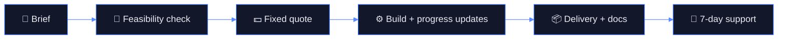

 

**Turn any authorized app or website workflow into a clean, documented API, a reliable scraper, or a bot that runs itself.**

 

[Services](#-services) · [Process](#-how-a-project-runs) · [Deliverables](#-what-you-get) · [Showcase](#-showcase) · [Stack](#-toolkit) · [FAQ](#-faq) · [Contact](#-contact)

---

> [!TIP]
> **Have an app or website you want automated?** Send the target and the goal to **[@anhafxd on Telegram](https://t.me/anhafxd)**. You get a free feasibility check and a fixed quote, usually within a few hours.

## 👋 About

I'm **Hadi Anhaf Aiman**, a Python automation engineer and full-stack developer, and I run **ANHAF**, an independent software studio. For 3 years I've built production systems that talk to platforms without an official API. I work out how the app communicates, document it properly, and ship code that keeps working.

Every engagement is on systems the client owns or is authorized to access. [Read the policy →](#-engagement-policy)

## 🧩 Services

<table>
<tr>
<td width="50%" valign="top">

### 🔍 Private API Analysis
I intercept and map the network traffic of mobile and web apps: endpoints, headers, auth and token flows, payloads.
 **You get:** full API documentation + OpenAPI spec

</td>
<td width="50%" valign="top">

### 🧱 Python SDK & Integration
I turn the mapped API into a typed, async Python client with retries, session handling and tests.
 **You get:** an installable SDK you can build on

</td>
</tr>
<tr>
<td valign="top">

### 🕷️ Web Scraping & Data Extraction
Structured data from static and JavaScript-rendered sites at scale, with clean exports to CSV, JSON or a database.
 **You get:** a scheduled scraper + clean dataset

</td>
<td valign="top">

### 🤖 Browser Automation
Playwright workflows that do repetitive work on the accounts you own: forms, dashboards, reports, uploads.
 **You get:** a headless worker that runs on schedule

</td>
</tr>
<tr>
<td valign="top">

### 💬 Telegram Bots & Alerts
aiogram bots for notifications, admin panels, payments and workflows, connected to your data.
 **You get:** a deployed bot + admin commands

</td>
<td valign="top">

### 🛡️ API & App Security Testing
Authorized testing of your own APIs and apps for broken auth, IDOR, exposed endpoints and weak token handling.
 **You get:** a findings report + fixes

</td>
</tr>
</table>

## 🔄 How a Project Runs

| Step | What happens |
|:--|:--|
| **Brief** | You send the target app or site, what you want automated, and the output you need. |
| **Feasibility check** | I analyse the target and confirm what's possible before you pay anything. |
| **Fixed quote** | You get a clear price, timeline and milestones. No surprises. |
| **Build** | I share progress as I go, so you see the work, not just the result. |
| **Delivery** | Source code, documentation, setup guide, and a walkthrough if you need one. |
| **Support** | 7 days of free fixes after delivery. Maintenance plans are available. |

## 📦 What You Get

- ✅ **Full source code**: yours to keep, no lock-in
- ✅ **API documentation**: an OpenAPI spec and a readable endpoint reference
- ✅ **Clean, tested Python**: typed, async where it matters, easy to extend
- ✅ **Config via `.env`**: no hard-coded secrets
- ✅ **Deployment ready**: Docker or VPS setup on request
- ✅ **NDA on request**: your project stays private

## 📁 Showcase

Client work stays private. These anonymized summaries show the kind of problems I solve.

| Project | Problem | Solution | Result |
|:--|:--|:--|:--|
| **[ADD: project name]** | [ADD: what the client needed] | [ADD: what you built] | [ADD: real outcome] |
| **[ADD: project name]** | [ADD] | [ADD] | [ADD] |
| **[ADD: project name]** | [ADD] | [ADD] | [ADD] |

Public demos live in [`/examples`](examples) as they're published.

## 🧰 Toolkit

| Area | Tools |
|:--|:--|
| **Traffic analysis** | mitmproxy · Frida · Burp Suite · Charles Proxy · Wireshark |
| **App analysis** | jadx · apktool · Ghidra |
| **Scraping** | Playwright · Camoufox · httpx · BeautifulSoup · Scrapy |
| **Bots** | aiogram · Telethon |
| **Backend** | FastAPI · PostgreSQL · Redis |
| **Infra** | Docker · Linux VPS · GitHub Actions |

## 📜 Engagement Policy

- I only work on systems you **own** or are **authorized** to access.
- I respect platform terms and data-protection law, and I don't take work that harms users or third parties.
- Security testing happens only with written permission and within a defined scope.
- NDAs are signed on request. Client code and data are never shared.

## ❓ FAQ

<b>Can you automate an app that has no public API?</b>

 
Usually, yes. Most apps talk to a backend over HTTP. I analyse that traffic, document it, and build a client around it, as long as the work is authorized.

<b>What happens when the app updates?</b>

 
Code is structured so endpoint changes are quick to patch. Fixes in the first 7 days are free, and maintenance plans cover ongoing updates.

<b>How long does a project take?</b>

 
Simple scrapers and bots take 1–2 days. API analysis plus an SDK takes 3–7 days, depending on complexity and auth.

<b>How does payment work?</b>

 
Fixed price, agreed before work starts. Larger projects are split into milestones.

<b>Do I get the source code?</b>

 
Yes. Full source, documentation and setup instructions. It's yours.

<b>Is this legal?</b>

 
Analysing traffic of apps you own or have permission to work with is standard engineering and security practice. I check every request against the <a href="#-engagement-policy">engagement policy</a> before quoting.

## 📬 Contact

---

<b>ANHAF</b> · Software you can rely on. © 2026 F. ANHAF DEV

